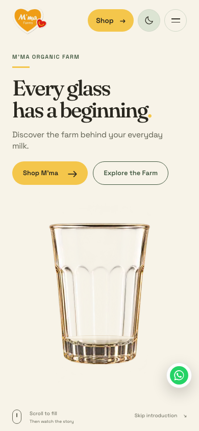
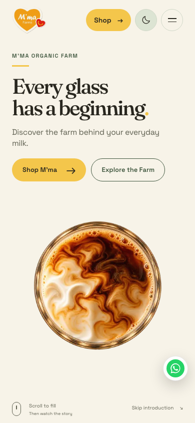
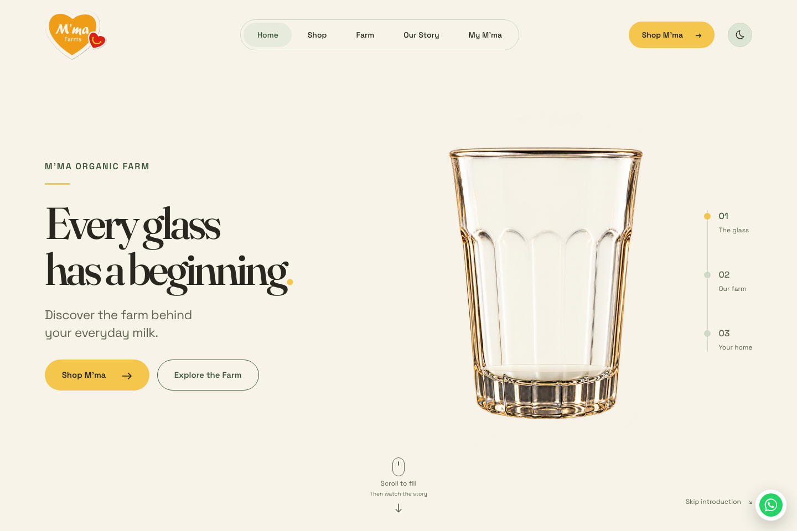
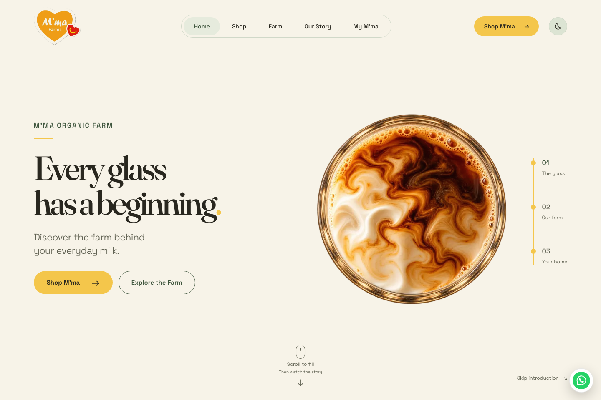

# Hybrid hero verification

Base: `main` at `5d819602e686357265ac86d6aa8c766a285af25e`. The motion correction is isolated from open PRs [#4](https://github.com/vartmaansharma-blip/mmaorganicfarm/pull/4) and [#5](https://github.com/vartmaansharma-blip/mmaorganicfarm/pull/5). The logo, fonts, palette, approved photographic files, image transforms, copy, CTA destinations and commerce code are preserved.

## Behavior

Scroll fills the traditional glass over 55svh. At full milk a single 1900ms timeline plays front milk → coffee → elevated → macro push/hold → overhead pull/settle. Additional wheel/touch/keyboard scroll input cannot select shots, restart the clock or reverse a partial forward film. The hold preserves the original sticky header/panel geometry and compensates for scrollbar width. Completion releases native scrolling at the end of filling, without the old long scroll runway.

Returning from content triggers the identical film backward, finishes on full frontal milk and permits upward emptying. A fill deadband prevents immediate jitter replay. Skip, anchors, route navigation, menu opening, pagehide and unmount release the temporary hold. Hidden documents pause the clock; resize/theme changes preserve it. Reduced motion has no timed hold. Actual responsive imagery decodes before playback; a 1500ms loading budget/failure fallback retains a loaded frontal glass without a late camera jump.

## Reproduce

```sh
npm run typecheck
npm run lint
npm run build
npm test
HERO_BROWSERS=chromium,webkit npm run test:browser
```

The browser script saves `work/hero-verification/results.json`, screenshots and WebM recordings. `HERO_WIDTHS=390,1440` optionally narrows the viewport matrix during debugging.

## Evidence and boundaries

Verified on 25 October 2026:

| Check | Result |
| --- | --- |
| `npm run typecheck` | Pass. |
| `npm run lint` | Pass: zero errors, two pre-existing warnings in untouched customer files. |
| `npm run build` | Pass: optimized production build. |
| `npm test` | Pass: fresh production build and all 35 source/unit checks, including eight motion tests. |
| `HERO_BROWSERS=chromium,webkit npm run test:browser` | Pass: all 12 engine/viewport combinations; all seven forward and seven reverse stages in order. |
| Desktop/phone lifecycle | Pass in both engines: hidden-time pause/resume, macro skip, route release, back/forward, direct anchor, preference change. |
| Image preparation | Pass in both engines: delayed and failed decoding release the hold and retain a stable frontal fallback. |
| Reduced motion | Static finished hero, no timed hold/runway, both engines. |
| Existing connected pages | Nine public routes in two themes per engine; contrast/typography checks pass. |
| Browser page errors | Zero in the final run. |

Application revision: `e07a265fda5015af049c4b3dd5abf96e1dd329dc`. Subsequent branch changes contain the final 60-second test-navigation allowance and review evidence; application code is unchanged. [Measured stage order/timing and full browser results](hero-timed-results.json). The PR carries the exact final preview and merge/deployment state. The browser matrix uses Chromium and desktop WebKit with phone viewport/touch emulation. Chromium also receives a native DevTools touch gesture; WebKit touch momentum is represented by cancelable DOM touch events and large native wheel deltas. Visibility pause/resume uses the browser's visibility-event adapter. Physical Safari/iPhone/Android testing, authenticated order writes and payment tests are outside this verification.

The user subsequently authorized direct merge on 25 October 2026 once the work is complete. Local checks and hosted preview verification must pass before merge; verify the deployment triggered by the existing main-branch integration afterward.

## Visual review

The original viewport composition is retained before, during and after the hold. Visual inspection includes sampled forward/reverse video frames in addition to stage-order assertions. The hold test compares its panel position against the original filling position and checks the header remains at the viewport top.

| Phone arrival | Phone overhead finish |
| --- | --- |
|  |  |

| Desktop arrival | Desktop overhead finish |
| --- | --- |
|  |  |

Recordings include filling, the uninterrupted forward film, free scrolling, reverse playback and subsequent emptying, plus the surrounding navigation checks: [phone WebM](recordings/hero-timed/chromium-phone-forward-reverse.webm), [desktop WebM](recordings/hero-timed/chromium-desktop-forward-reverse.webm). The test deliberately switches theme and makes a one-pixel resize during forward playback to verify that neither restarts it.
