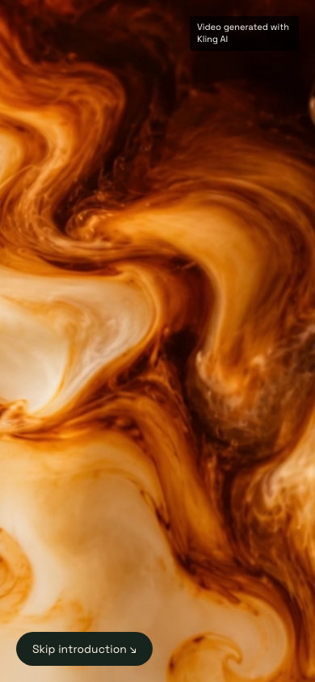
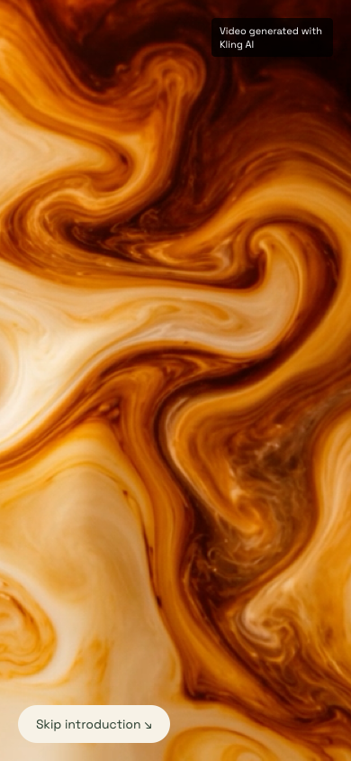
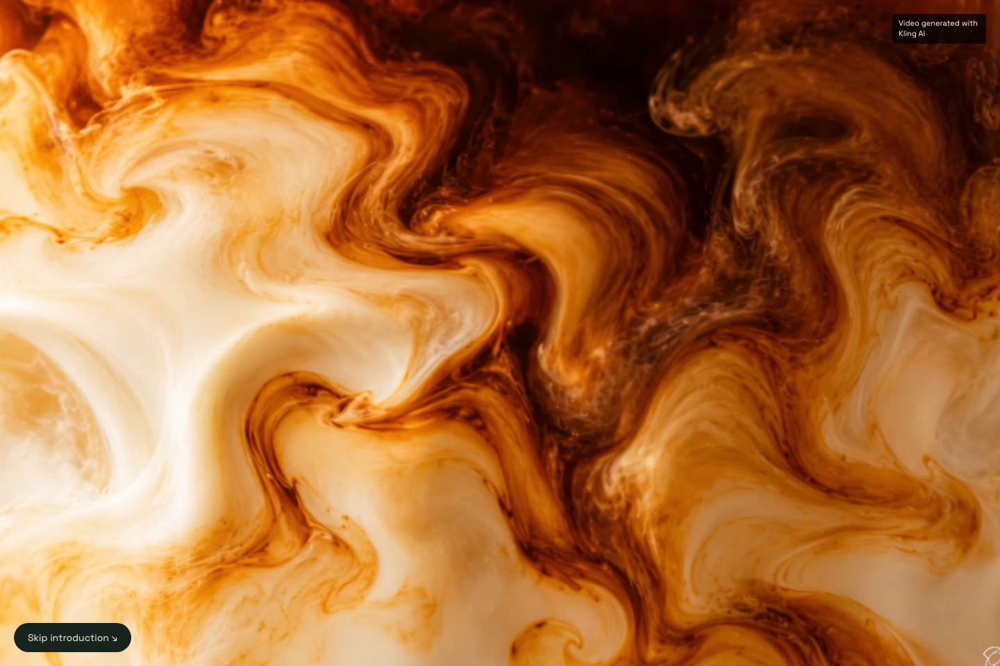
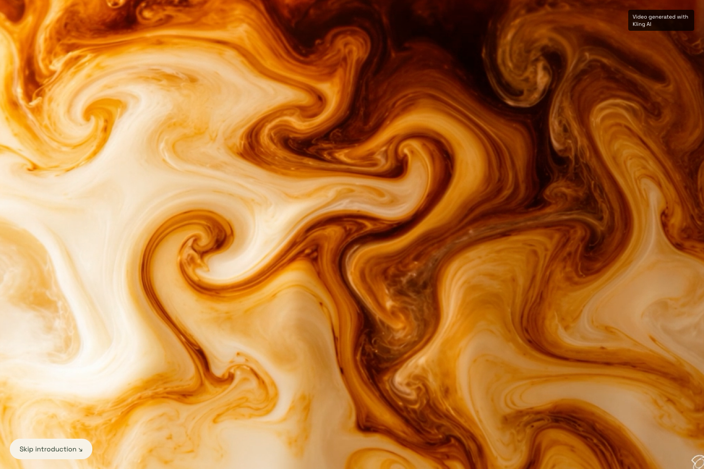
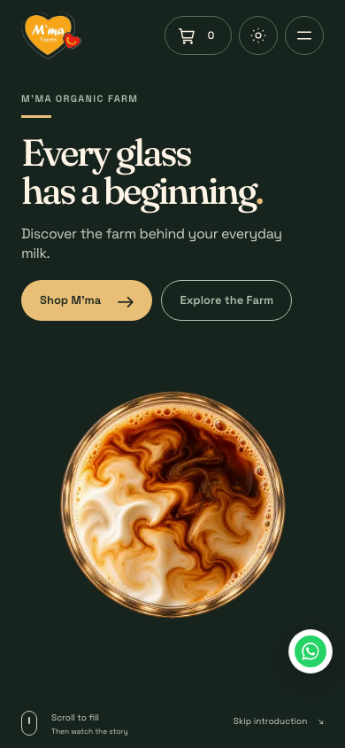
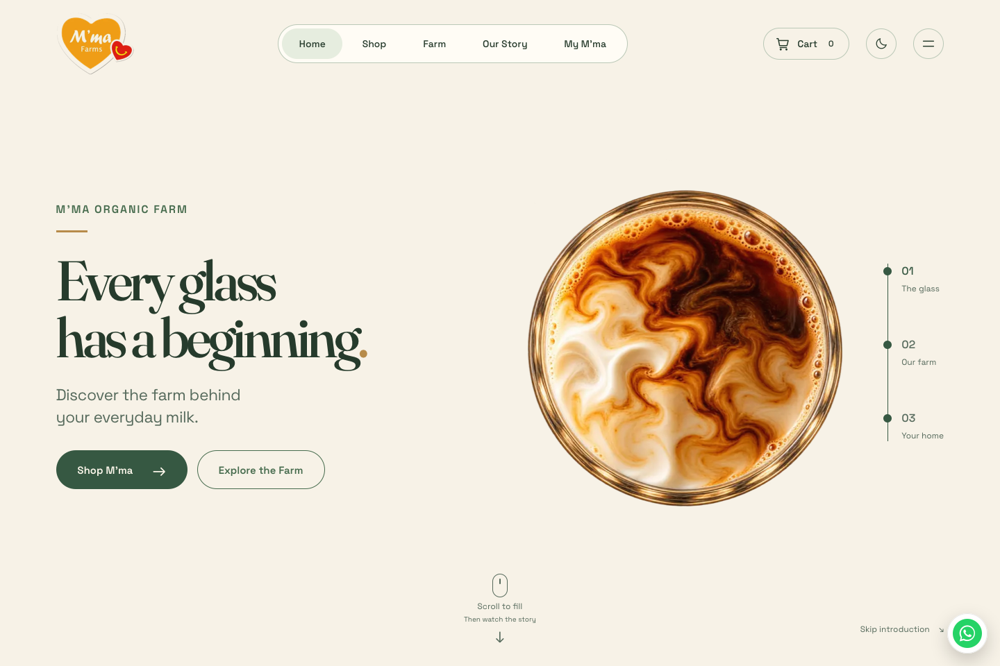

# Approved coffee-swirl integration verification — 30 October 2026

Base: `main` at `4b0e36702ec8ce785f0c2e93893092cf5d8981d9`. The final native-ended adapter confirms a buffered last-frame presentation before overhead. Final application/evidence revisions are recorded in PR #28. Only the hero macro, its clock/media adapter, related documentation and test fixtures change.

## Verified source

`public/hero/coffee-macro-motion.mp4` is the unchanged approved source: SHA-256 `cc255f456ffa3304be88bcdc40fc1fd9671c46762b4ca0d82ed4039e5b206612`, 3,155,596 bytes, H.264/AVC, 1284×724, 3.041667 seconds and one video track with no audio track. The test parses the MP4 atoms and checks its full hash. Browser decoding independently confirms its dimensions/duration. The first decoded frame closely matches the approved macro still (mean absolute channel difference approximately 3/255 after equal-size comparison, including compression and watermark differences). The media is never transcoded.

## Checks

Application revision: `800d85b34c3ae2151fd6d3518028b01a80773821`. The video adapter waits for full native playback, then confirms the final buffered frame before overhead. Subsequent changes record evidence only. Native playback completion and the immutable file are checked separately from presented-frame callbacks, which browsers may omit under capture load.

| Check | Result |
| --- | --- |
| Production build and `npm test` | Pass, 118 tests including media integrity, timeline, lifecycle-adapter and existing commerce/auth checks. |
| TypeScript | Pass. |
| ESLint | Zero errors; one pre-existing image warning in untouched `public-information-layout.tsx`. |
| Chromium and WebKit, 390×844 and 1440×960, dark/light | Pass: all eight scenarios. Playback starts at time zero, opening presentation callbacks arrive within one 24fps frame, decoded liquid moves without black frames, 1× muted playback occurs once, poster/video crop matches, credit stays visible, overhead waits for ended state, scroll unlocks and reverse uses the still. |
| Presented final hold | Pass in all eight scenarios: exact equality with an independent decode of the final source frame, after native playback emits `ended`. One buffered final seek avoids the inconsistent final image observed in hosted WebKit before this correction. WebKit rounds duration to 3.042s; media atoms remain exactly 73/24s. |
| Video visibility and skip | Pass in both engines: pause/resume without rewinding, followed by immediate skip release. |
| Media failure and reduced-motion matrix | Pass: ten scenarios across both engines covering failed/slow loading, rejected autoplay, stalled playback and reduced motion. Late video does not replace the selected fallback. |
| Existing hero/public-route browser matrix | Pass: eight final engine/viewport cases (320, 390, 768 and 1440px in Chromium and WebKit); all forward/reverse stages, filling, keyboard/menu, scroll lock/unlock, theme/resize, skip, back/forward, anchors, visibility and image-failure checks. Nine connected public routes pass in both themes in each engine. Zero page runtime errors. |
| Hosted preview | The exact deployed head, canonical preview URL and hosted verification result are recorded in [draft PR #28](https://github.com/vartmaansharma-blip/mmaorganicfarm/pull/28). This table records the completed local production-build checks. |

## Reproduce

```sh
npm ci
NEXT_PUBLIC_SUPABASE_URL=http://127.0.0.1:3199 \
NEXT_PUBLIC_SUPABASE_PUBLISHABLE_KEY=sb_publishable_hero_browser_fixture npm test
npm run typecheck
npm run lint
HERO_BROWSERS=chromium,webkit npm run test:hero-video
HERO_TEST_PORT=3104 HERO_BROWSERS=chromium,webkit HERO_WIDTHS=320,390,768,1440 npm run test:browser
```

Run the browser commands sequentially. Their local protocol fixture permits only anonymous catalogue GETs and rejects writes. It exists because the current homepage requires a catalogue response. There are no production credentials or customer records in these checks. Browser artifacts are in `work/hero-video-verification/` and `work/hero-verification/`. [Measured video results](hero-video-results.json) and [complete hero/public-route results](hero-video-regression-results.json) include source hash, presented-frame samples, native media events, stage timing and final-frame equality. WebM recordings remain in the local artifact folders. The hosted preview result is recorded in the PR against the final deployed head; no test credential or temporary access token is committed.

## Release boundary

The clip visibly contains “KlingAI 4.0”. The source watermark remains untouched; the viewport credit preserves visible attribution under responsive crop. The approved clip was also imported, with the user's explicit authorization, into their Canva library as **M’ma approved coffee swirl — original silent clip** (`VAHZX5kjcws`). No Canva re-export replaces the approved file.

The [Kling general terms](https://kling.ai/docs/user-policy) §4.6 and [paid-service terms](https://kling.ai/docs/payment-policy) §3.1.2 distinguish regular-account restrictions and member commercial-use benefits (checked 29 October 2026). Account/date/plan or written permission covering this exact clip remains unverified. Keep the PR in draft and the deployment in preview pending that evidence. Import into Canva does not supply a license for the source.

Chromium and desktop WebKit with emulated phone sizes are browser-engine checks. They do not establish physical iPhone/Safari or Android device reliability. No live order, payment, database mutation, production merge or production deployment is part of this work.


## Desktop and mobile captures

| Phone, dark macro | Phone, light macro |
| --- | --- |
|  |  |

| Desktop, dark macro | Desktop, light macro |
| --- | --- |
|  |  |

| Phone overhead | Desktop overhead |
| --- | --- |
|  |  |
